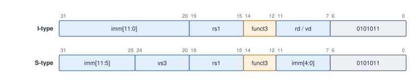

# Accelerator ISA reference

This is the instruction set of the reference design, which the kernels in
`sw/tests/` are written in. You may change it together with your hardware
and kernels ([project-guide.md](project-guide.md#what-is-fixed-and-what-is-yours)).

The accelerator's control core executes 32-bit RISC-V-encoded instructions:
the **RV32I base subset** for control flow and address arithmetic, plus
four **custom extensions** in the RISC-V custom opcode space:

| Opcode | Name | Contents |
|---|---|---|
| `0x0B` (custom-0) | VARITH | bf16 vector arithmetic |
| `0x2B` (custom-1) | VMEM | vector length and vector loads/stores |
| `0x5B` (custom-2) | MATRIX | tile loads/stores and matrix multiply-accumulate |
| `0x7B` (custom-3) | CTRL | multi-core synchronization (`barrier`) |

Every compute core executes this ISA independently. All launched cores run
the same kernel; see [Multi-core kernels](#multi-core-kernels-custom-3-0x7b).

Kernels are ordinary GNU assembler files. The extensions are macros in
[`sw/common/accel_isa.h`](../sw/common/accel_isa.h) that emit these encodings
with `.insn`, so the stock `riscv64-unknown-elf-as` assembles everything.
Source of truth for encodings is [`hw/rtl/accel_pkg.sv`](../hw/rtl/accel_pkg.sv).

## Architectural state

| State | Size | Reset at launch? |
|---|---|---|
| `x0..x31` | 32 x 32 bit, `x0` = 0 | yes: all 0 except `a0..a7` = `ARG0..ARG7` |
| `pc` | 32 bit | `START_PC` |
| `vl` | 0..VLMAX | `VLMAX` |
| `v0..v31` | 32 x VLEN bits (VLMAX = VLEN/16 bf16 elements) | **no** |
| `tr0..tr{NUM_TREGS-1}` | MAT_DIM x MAT_DIM bf16 each | **no** |
| `acc0..acc{NUM_ACCS-1}` | MAT_DIM x MAT_DIM fp32 each | **no** |

All of this state is **per core**: each core has its own registers, vl and
scratchpad.

Element `i` of a vector register is bits `[16i+15:16i]`. Element `(r, c)` of
a tile is element `c` of row `r`, and rows map to memory the same way vectors
do: element `c` at byte offset `2c`.

## Scalar instructions (RV32I subset)

| Supported | Notes |
|---|---|
| `lui auipc jal jalr` | |
| `beq bne blt bge bltu bgeu` | |
| `lb lh lw lbu lhu sb sh sw` | to HBM or the scratchpad; must be naturally aligned |
| `addi slti sltiu xori ori andi slli srli srai` | |
| `add sub sll slt sltu xor srl sra or and` | |
| `fence` | no-op (all accesses are already ordered) |
| `ecall` | **end of kernel**: success (`STATUS.DONE`) |
| `ebreak` | end of kernel with error `EBREAK` (useful as an assert) |
| `csrr rd, csr` (= `csrrs rd, csr, x0`) | read-only CSRs below |

Not supported, and they raise `ILLEGAL`: M/A/F/D/C extensions, CSR writes,
`mret`/`wfi`, `fence.i`, interrupts. Kernels compute addresses with shifts
and adds. The host has a full RV64G core if you need anything fancier.

Readable CSRs:

| CSR | Number | Value |
|---|---|---|
| `cycle` / `cycleh` | `0xC00` / `0xC80` | cycles since launch |
| `instret` / `instreth` | `0xC02` / `0xC82` | instructions retired since launch |
| `vl` | `0xC20` | current vector length |
| `vlenb` | `0xC22` | VLEN/8 (bytes per vector register) |
| `mhartid` | `0xF14` | this core's index, `0 .. ncores-1` |
| `ncores` | `0xFC0` | number of cores launched together (`CORES` register) |
| `spadsz` | `0xFC1` | scratchpad bytes per core (`SPAD_KB*1024`, 0 if none) |
| `units` | `0xFC2` | bit 0: this core has a vector unit, bit 1: a matrix unit (`NUM_VPUS`, `NUM_MXUS`). Vector / matrix instructions on a core without the unit raise `ILLEGAL` |

`cycle` and `instret` count per core. Use the numeric form or the names
from `accel_isa.h` (`CSR_VL`, `CSR_VLENB`, `CSR_NCORES`, `CSR_SPADSZ`, `CSR_UNITS`), e.g.
`csrr t0, CSR_NCORES`. `mhartid`, `cycle` and `instret` are known to the
assembler by name.

## Address space

The same 32-bit addresses as the host (see [memory-map.md](memory-map.md)),
plus one accelerator-only window:

| Range | What | Notes |
|---|---|---|
| `0x2000_0000 .. +SPAD_KB KiB` | this core's **scratchpad** | each core has its own; 1-cycle SRAM; beyond SPAD_KB (inside the 16 MiB window) -> `BUS` |
| `0x4000_0000 .. 0x7FFF_FFFF` | HBM | shared by all cores and the host |
| anything else | | `BUS` error |

Every load and store instruction (scalar, vector and matrix) works on both,
with the same alignment rules. The instruction alone does not decide where
the data goes; the address does.

## Vector configuration and memory (custom-1, `0x2B`)

| Assembly | Format | funct3 | Semantics |
|---|---|---|---|
| `vsetvl rd, rs1` | I | 0 | `vl = min(x[rs1], VLMAX)` (`rs1 = zero` means VLMAX); `x[rd] = vl` |
| `vle16 vd, imm(rs1)` | I | 1 | `vd[i] = mem16[x[rs1] + imm + 2i]` for `i < vl` |
| `vse16 vs3, imm(rs1)` | S | 2 | `mem16[x[rs1] + imm + 2i] = vs3[i]` for `i < vl` |



The effective address of `vle16`/`vse16` **must be a multiple of VLEN/8**
(else `MISALIGNED`). A `vle16` always reads the full VLEN/8 bytes from memory
but writes only elements `< vl`. A `vse16` writes only the bytes of elements
`< vl`. Keep buffers padded to a multiple of VLEN/8 bytes.

**Strip-mining idiom** (works for every VLEN):

```asm
1:  vsetvl  t0, a0        # t0 = elements this iteration
    vle16   v1, 0(a1)
    ...
    sub     a0, a0, t0
    slli    t1, t0, 1
    add     a1, a1, t1
    bnez    a0, 1b
```

## Vector arithmetic (custom-0, `0x0B`)

R-type, `funct7` = operation, `funct3` = operand form:


* `funct3 = 0` (`.vv`): op1 = `vs1`
* `funct3 = 4` (`.vf`): op1 = broadcast(`x[rs1][15:0]`), a bf16 bit pattern in a scalar register

All operations act on elements `i < vl`. Elements `i >= vl` of `vd` are
unchanged. Arithmetic follows [numerics.md](numerics.md).

| funct7 | Assembly (`.vv` / `.vf`) | Semantics (per element) |
|---|---|---|
| `0x00` | `vfadd.vv vd, vs2, vs1` / `vfadd.vf vd, vs2, rs1` | `vd = vs2 + op1` |
| `0x01` | `vfsub.vv vd, vs2, vs1` / `vfsub.vf vd, vs2, rs1` | `vd = vs2 - op1` |
| `0x02` | `vfmul.vv vd, vs2, vs1` / `vfmul.vf vd, vs2, rs1` | `vd = vs2 * op1` |
| `0x03` | `vfmax.vv vd, vs2, vs1` / `vfmax.vf vd, vs2, rs1` | `vd = max(vs2, op1)` |
| `0x04` | `vfmin.vv vd, vs2, vs1` / `vfmin.vf vd, vs2, rs1` | `vd = min(vs2, op1)` |
| `0x05` | `vfmacc.vv vd, vs1, vs2` / `vfmacc.vf vd, rs1, vs2` | `vd = vd + vs2 * op1` (product exact, one rounding) |
| `0x08` | `vfredsum.vs vd, vs2, vs1` / `vfredsum.vf vd, vs2, rs1` | `vd[0] = op1[0] + vs2[0] + ... + vs2[vl-1]` (in that order, fp32, rounded once) |
| `0x09` | `vfredmax.vs vd, vs2, vs1` / `vfredmax.vf vd, vs2, rs1` | `vd[0] = max(op1[0], vs2[0..vl-1])` |
| `0x10` | `vmv.v.v vd, vs1` / `vmv.v.x vd, rs1` | `vd = op1` (bit copy, no DAZ) |
| `0x11` | `vmv.x.s rd, vs2` (funct3 0) | `x[rd] = zero_extend(vs2[0])` (ignores vl) |
| `0x12` | `vmv.s.x vd, rs1` (funct3 4) | `vd[0] = x[rs1][15:0]` if `vl > 0` |

Reductions write only element 0 of `vd` and do nothing when `vl = 0`.
Handy idioms: ReLU is `vfmax.vf vd, vs, zero`, negation is `vfsub` from a
zero vector, and a dot product is `vfmul` followed by `vfredsum`.

## Matrix unit (custom-2, `0x5B`)

R-type, `funct7` = operation, `funct3` = memory layout (`0` normal, `1`
transposed `.t`):


| funct7 | Assembly | Semantics |
|---|---|---|
| `0x00` | `mld tr, rbase, rstride` | for r < MAT_DIM: tile row r = mem[x[rbase] + r*x[rstride]] (MAT_DIM*2 bytes) |
| `0x00` | `mld.t tr, rbase, rstride` | same, but memory row r becomes tile **column** r |
| `0x01` | `mst tr, rbase, rstride` / `mst.t` | tile row (column) r -> mem[x[rbase] + r*x[rstride]] |
| `0x02` | `msta acc, rbase, rstride` / `msta.t` | bf16(acc) row (column) r -> memory, rounded RNE |
| `0x03` | `mzero acc` | acc = +0.0 everywhere |
| `0x04` | `mmacc acc, ta, tb` | acc += ta x tb, i.e. `acc[i][j] += sum_k ta[i][k] * tb[k][j]` (k ascending, fp32) |

Here `tr`/`acc`/`ta`/`tb` are register *indices* (written `trN` / `accN` in
assembly), while `rbase`/`rstride` are scalar registers holding a byte
address and a byte stride. Rules:

* `x[rbase]` and `x[rstride]` must both be multiples of `MAT_DIM*2` (else
  `MISALIGNED`). Strides can be any such multiple, which lets a tile be cut
  out of a larger matrix.
* Indices `>= NUM_TREGS` / `>= NUM_ACCS` raise `BAD_REG`.
* `mzero`/`mmacc` with `funct3 = 1` are `ILLEGAL`.

[memory-formats.md](memory-formats.md) shows how row-major, column-major and
blocked matrices map onto these instructions.

## Multi-core kernels (custom-3, `0x7B`)

| Assembly | Encoding | Semantics |
|---|---|---|
| `barrier` | `0x0000007B` | wait until every launched core is waiting at a barrier or has finished (`ecall` or fault), then continue together |
| `hcpy rd, rs1, rs2` | R-type, funct3 = 1, funct7 = 0 | copy `x[rs2]` halfwords (bf16 elements) from address `x[rs1]` to address `x[rd]`; `rd` is read, not written |
| `hcpy2d rd, rs1, rs2` | R-type, funct3 = 2, funct7 = 0 | `x[rs2] = {stride[31:16], rows[15:8], run[7:0]}`: copy `rows` runs of `run` halfwords, run *r* from `x[rs1] + r*stride` (bytes), all back to back from `x[rd]`; `rd` is read, not written |

`hcpy` takes any 2-byte-aligned source and destination, in HBM or the
scratchpad, and any count (0 copies nothing). It exists for im2col, whose
runs of `K x Cin` elements start at arbitrary element addresses. An odd
source or destination address is `MISALIGNED`, an address outside memory
`BUS`. The source and destination must not overlap. The hardware moves one
chunk per write, a chunk being whatever fits before the source or the
destination crosses a bus beat.

`hcpy2d` is the same copy repeated: it gathers a 2-D window (`rows` rows of
`run` elements, `stride` bytes apart in the source) into one contiguous
destination, which is exactly one im2col patch row (`rows = K`,
`run = K x Cin`, `stride` = one input row). `rows = 0` or `run = 0` copies
nothing; an odd `stride` is `MISALIGNED`, as are odd addresses.

Other encodings in custom-3 are `ILLEGAL`. Writes to HBM issued before a
barrier are visible to all cores after it (each core finishes every memory
access before its next instruction). Finished cores count as arrived, so a
core that exits early cannot deadlock the others. If any core faults, the
others stop at their next fetch or barrier.

Typical structure:

```asm
    csrr  s0, mhartid          # my index
    csrr  s1, CSR_NCORES       # how many of us
    # work item w = s0, s0 + s1, s0 + 2*s1, ...  (e.g. output tiles)
    ...
    barrier                    # everyone's results are now in HBM
    bnez  s0, 1f               # core 0 does the final step alone
    ...
1:  ecall
```

## Errors

A fault stops the kernel and sets `STATUS.DONE`, `STATUS.ERROR`,
`STATUS.ERR_CAUSE`, `ERR_PC` (the faulting instruction) and `ERR_INSN` (its
encoding, 0 for fetch faults and `ebreak`). With several cores, the first
core to fault is reported (`ERR_CORE`) and the others are stopped:

| Cause | Name | Raised by |
|---|---|---|
| 1 | `ILLEGAL` | unknown opcode / funct, unsupported RV32 extension |
| 2 | `MISALIGNED` | misaligned PC, scalar, vector or matrix access |
| 3 | `BUS` | AXI `SLVERR`/`DECERR` (e.g. address outside HBM), or a scratchpad address beyond `SPAD_KB` |
| 4 | `EBREAK` | `ebreak` |
| 5 | `BAD_REG` | tile/accumulator index out of range |

## Adding an instruction

1. Pick a free `funct7`/`funct3` in one of the custom opcodes (custom-3
   has plenty of room) and add a constant to `accel_pkg.sv`.
2. Implement it: decode in the control core, and the datapath in the
   vector unit, the matrix unit or a new unit.
3. Add an assembler macro to `sw/common/accel_isa.h`.
4. Add the reference semantics to `sw/common/bf16.h` (if numeric) and a test
   under `sw/tests/`.
5. Document it here.