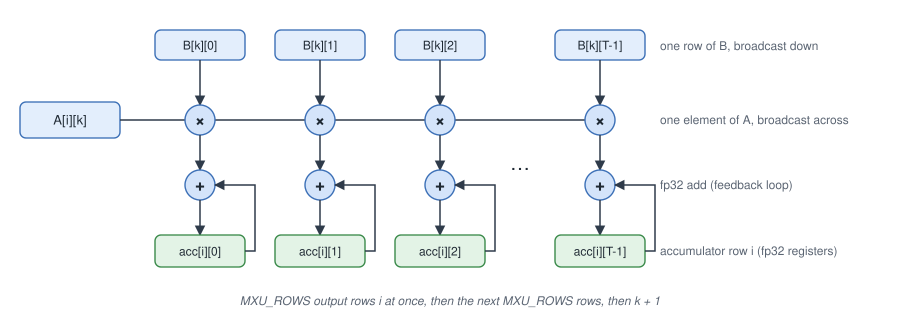
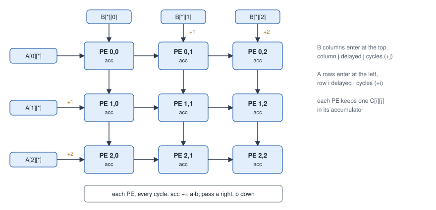
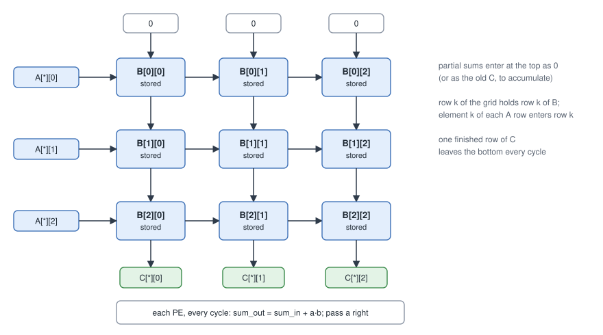

# Matrix engines: tiled accumulators, dot-product engines, systolic arrays

The matrix unit has one job: for `T x T` tiles (`T = MAT_DIM`),

```
C[i][j] += sum over k of A[i][k] * B[k][j]        i, j, k = 0 .. T-1
```

That is `T^3` multiply-accumulates (MACs) per tile product. Every design
has to decide three things:

1. **How many MACs happen per cycle**, and which ones.
2. **How the operands get to the multipliers**: broadcast on long wires,
   or passed from neighbour to neighbour.
3. **Where the running sums live**: registers next to each adder, a
   register file, or a memory.

The three classic answers are below. All three compute the same tile
product and can sit behind the same instruction (`mmacc acc, ta, tb`), so
the kernels and tests do not care which one you build. They differ in area,
clock period, cycles per product and the order of the additions.

Notation: `T = MAT_DIM`. A "MAC unit" is one bf16 multiplier plus one fp32
adder. "Peak MACs/cycle" is what the engine does when it is never waiting
for data.

## At a glance

| | Tiled accumulator | Dot-product engine | Systolic array |
|---|---|---|---|
| MAC units | `R x T` (`R = MXU_ROWS`) | `P x T` (`P` engines) | `T x T` |
| Cycles per tile product | `T^2 / R` | `T^2 / P` (+ tree latency) | `T` when products follow each other; `3T - 2` for a single one |
| Peak MACs/cycle | `R x T` | `P x T` | `T^2` |
| Operands arrive by | broadcast: one A element to `T` multipliers, one B row to `R` rows | broadcast: one A row and one B column to `T` multipliers | neighbour-to-neighbour, one hop per cycle |
| Running sums live in | `T^2` fp32 accumulator registers | nowhere inside a dot product; one adder per engine adds the result to `C` | one register per processing element, or they flow through |
| Feedback loop on the adder | yes: `acc += product` | no (adder tree is feed-forward) | output-stationary: yes, every cycle; weight-stationary: no |
| Summation order | `k = 0, 1, ..` in sequence | pairwise (tree) | `k = 0, 1, ..` in sequence |
| Matches `bf16.h` bit for bit | yes | no, within tolerance | yes, if each step rounds like `fp32_add` |
| What limits the clock | accumulator select + adder loop | nothing structural: add pipeline stages to the tree | output-stationary: the adder loop; weight-stationary: one MAC stage |
| The reference design | this one | | |

## 1. Tiled accumulator (the reference design)

A row of MAC units per output row, with operands broadcast and the sums
kept in a register tile. Each cycle handles one `k` for `R` output rows:



```
for k in 0 .. T-1:                       # outer loop: fixes the summation order
  for each group of R output rows:       # one cycle per group
    for i in group, j in 0 .. T-1:       # R x T MAC units, in parallel
      acc[i][j] = fp32_add(acc[i][j], A[i][k] * B[k][j])
```

* **Cycles:** `T^2 / R` per `mmacc`. `R = 1` is a single row of `T` MAC
  units; `R = T` updates the whole tile every cycle.
* **Area:** `R x T` MAC units, plus `T^2` 32-bit accumulators per
  accumulator register and the multiplexers that pick `R` of the `T` rows.
  In the reference design at the default size this is a third of the chip
  per core ([synthesis.md](synthesis.md#reference-results)).
* **Timing:** the critical path is *read accumulator row -> fp32 add ->
  write accumulator row*, a feedback loop. Each row is only touched once
  every `T / R` cycles, so the adder can be given two cycles without losing
  throughput as long as `R < T`
  ([synthesis.md](synthesis.md#timing-bottlenecks)).
* **Numerics:** the additions for one output element happen in the order
  `k = 0, 1, ..., T-1`, each rounded to fp32. This is exactly the reference
  model (`mxu_matmul_ref` in `bf16.h`), so results match bit for bit.
* **Good at:** simplicity, low latency, a direct trade of area against
  cycles with one parameter, and accumulating over many `mmacc` (the sums
  just stay in the registers).
* **Weak at:** the broadcast wires and accumulator multiplexers grow with
  `T`, and the accumulators are expensive flip-flops.

## 2. Dot-product engine

Turn the loops inside out: finish one output element at a time. One engine
takes a whole row of A and a whole column of B, multiplies them pairwise
and adds the `T` products in a tree:

![Dot-product engine: T multipliers feed an adder tree of log2(T) levels; the result is added to C[i][j]](img/dot-product.svg)

```
for i in 0 .. T-1:
  for j in 0 .. T-1:                     # P engines work on P different (i, j) per cycle
    C[i][j] = C[i][j] + tree_sum(A[i][k] * B[k][j] for k in 0 .. T-1)
```

* **Cycles:** `T^2 / P` per tile product with `P` engines, plus the
  latency of the tree, paid once because the tree is a pipeline.
* **Area:** `P x T` multipliers and `P x (T - 1)` adders in the trees, plus
  `P` adders for `C`. There are **no per-element accumulator registers**:
  `C` is read and written one element (or one row) at a time, so it can
  live in the tile registers you already have, or in the scratchpad SRAM,
  which costs about a tenth of the area per bit ([sram.md](sram.md)).
* **Timing:** the tree has no feedback, so you can put a register after
  every level, or after every half adder, and reach whatever clock the
  rest of the design allows. The only loop is `C[i][j] + dot`, which
  happens once per element per tile product and can take several cycles.
* **Numerics:** a tree adds `(p0 + p1) + (p2 + p3)` where the reference
  adds `((p0 + p1) + p2) + p3`. The results differ in the last bits and are
  accepted by the tolerance check ([numerics.md](numerics.md)). You are
  also free to make the tree cheaper than `T - 1` full fp32 adders: align
  all products to the largest exponent, add them as integers, and normalize
  and round once at the end. That is one of the larger area savings
  available, as long as the result stays within tolerance.
* **Operands:** an engine needs a *row* of A and a *column* of B at the
  same time. Load B with `mld.t` (or store it transposed, see
  [memory-formats.md](memory-formats.md)) so that a column of B is a row of
  the tile register and comes out of a simple row read.
* **Good at:** high clock rates, small state, cheap adders, and
  matrix-vector products and fully connected layers, which are dot
  products to begin with.
* **Weak at:** each output needs the whole A row and B column at once, so
  the read ports are wide; and partial results over several `mmacc` (large
  `K`) must be read back and added, where the tiled accumulator just keeps
  them.

## 3. Systolic array

A `T x T` grid of identical processing elements (PEs). Each PE has one MAC
unit and a few registers and talks only to its neighbours. Data moves one
PE per cycle, like a bucket chain; nothing is broadcast.

### Output-stationary (each PE owns one output element)



`A[i][k]` enters row `i` at cycle `i + k` and `B[k][j]` enters column `j`
at cycle `j + k`, so they meet in PE `(i, j)` at cycle `i + j + k`: exactly
the pair that belongs to `C[i][j]`, in the order `k = 0, 1, ...`. After
`3T - 2` cycles every PE holds its `C[i][j]`.

### Weight-stationary (B stays put, partial sums flow)



B is loaded into the PEs once. Rows of A then stream through, one per
cycle, and a finished row of C drops out of the bottom every cycle. This is
the arrangement of Google's first TPU and the default of Gemmini, because a
layer's weights are reused for many inputs.

### Properties of both

* **Cycles:** a single tile product takes `3T - 2` cycles from the first
  input to the last output. A new product can start every `T` cycles, so in
  a stream of products the array does `T^2` MACs per cycle.
* **Area:** `T^2` MAC units, the most of the three, plus per PE two or
  three registers (16-bit operands, a 32-bit sum) and the delay registers
  that skew the inputs. There are no wide multiplexers and no broadcast
  buffers.
* **Timing:** every signal goes from a register to the neighbouring PE's
  register through one MAC unit. That path does not grow with `T`.
  * Output-stationary PEs add into the same register every cycle. That is
    the same `acc += product` loop as the tiled accumulator, without the
    spare cycles: the fp32 adder sets the clock unless the accumulator is
    kept in a form that is cheap to add to (for example unnormalized, or
    carry-save) and normalized only when read out.
  * Weight-stationary PEs pass the sum on to the next PE instead. Nothing
    feeds back, so the MAC can be split into as many pipeline stages as you
    like. This variant suits high clock rates best.
* **Numerics:** each output is still summed in the order `k = 0, 1, ...`.
  With a full `fp32_add` in every PE the results match `bf16.h` bit for
  bit.
* **Good at:** large `T`, high clock rates, long streams of products
  against the same B (convolutions, batched layers).
* **Weak at:** latency and area for small or occasional products, the
  control that skews the inputs and collects the outputs, and wasted work
  when a tile is only partly filled.

A caveat about measuring it here: synthesis uses a wire-load model, not a
placed layout, so the systolic array's main physical advantage, short
wires, shows up only indirectly (fewer buffers, lower fan-out). Its logic
depth advantage shows up fully.

## Fitting an engine into this project

**The instruction set does not have to change.** `mld` fills tile
registers, `mzero`/`mmacc` run the engine, `msta` writes the result
([isa.md](isa.md)). Whatever is behind `mmacc` only has to produce
`acc += ta x tb` within tolerance, and the tests `matmul`, `gemm`,
`layouts`, `gemm_tiled` and `lenet` check exactly that.

**But the best version of each engine wants its own interface**, and you
are free to change the instruction set to give it one
([project-guide.md](project-guide.md#what-is-fixed-and-what-is-yours)):

| Engine | Useful instruction-set changes |
|---|---|
| Tiled accumulator | fused epilogues (`msta` with ReLU or bias); `mmacc` that does not block the control core, so the next tiles load meanwhile |
| Dot-product engine | results written straight to memory instead of an accumulator tile; a matrix-vector instruction; accumulators in the scratchpad |
| Systolic array | streaming: "load these rows from memory and push them through the array", so data does not stop in tile registers; a separate "load weights" instruction for the weight-stationary form |

If you change the instruction set, change `accel_pkg.sv`, `accel_isa.h`,
the kernels and `docs/isa.md` together; the tests' result checks stay as
they are.

**Parameters.** `MXU_ROWS` means "output rows per cycle" in the tiled
accumulator. Give it the meaning that fits your engine (number of
dot-product engines, for instance) or ignore it, and report what you built
through the `CFG` registers so that software can adapt
([parameters.md](parameters.md)).

**Numerics.** Sequential engines can match the reference model exactly.
Tree and fixed-point engines cannot and do not have to: matrix results are
checked with `bf16_close()` ([numerics.md](numerics.md)). Element-wise
vector instructions remain bit-exact.

## Choosing

Start from the workload, not from the engine.

* **Where does the time go today?** In the reference design the matrix unit
  is idle most of the time: `gemm` reaches about 2 MACs per cycle against a
  peak of 64 per core, because every tile row is a separate round trip to
  HBM, and `lenet` spends about three quarters of its time in scalar copy
  loops ([architecture.md](architecture.md#performance)). A faster engine
  does nothing for either. Fix the memory path and the kernels first
  ([software-optimization.md](software-optimization.md)), then size the
  engine to what the memory path can feed.
* **The score is area x energy x time^2**
  ([competition.md](competition.md)). An engine that is twice as large must
  make the *whole workload* roughly 1.3 to 1.4 times faster just to pay for
  its area, and more than that once its extra power is counted.
* **Clock period is a design choice** (`design.clk_period_ns`). An engine
  with no feedback loop on its adder (dot-product tree, weight-stationary
  array) lets you shorten the clock for the whole accelerator; one with a
  loop holds the clock at about the delay of an fp32 add unless you rework
  the accumulator.

| If your workload is mostly ... | Consider |
|---|---|
| small tiles, few products, limited by memory | a small tiled accumulator (`R` of 1 or 2), and spend the area on the memory path |
| fully connected layers, matrix-vector products | dot-product engines |
| long streams against the same weights (convolutions, batches) | a weight-stationary systolic array |
| a bit of everything at a relaxed clock | the tiled accumulator with `R` tuned to the memory bandwidth |

## Checklist for a new engine

1. Decide the order of additions and whether you need the tolerance.
2. Write down cycles per tile product and MAC units as formulas of `T`
   before writing RTL; check them against the simulation afterwards.
3. Keep the unit behind a small interface (command in, done out, row
   read/write ports) so it can be tested by `matmul` alone.
4. Run `matmul`, `gemm` and `layouts` in two configurations with HBM
   back-pressure (`SIM_ARGS=+hbm_stall_pct=25`).
5. Synthesize it alone first if it is large (`make synth
   SYNTH_ELAB_ONLY=1` for syntax, then a full run), and read
   `reports/timing.rpt`: is the critical path where you expected?
6. Measure the workload, not the unit: `make score TEST=lenet`.

## Further reading

* H. T. Kung, "Why Systolic Architectures?", IEEE Computer, 1982.
* N. Jouppi et al., "In-Datacenter Performance Analysis of a Tensor
  Processing Unit", ISCA 2017 (a weight-stationary systolic array at
  scale).
* H. Genc et al., "Gemmini: Enabling Systematic Deep-Learning Architecture
  Evaluation via Full-Stack Integration", DAC 2021 (a generator whose
  matrix unit can be built as a pipelined systolic array or as a parallel,
  combinational array from one description).
